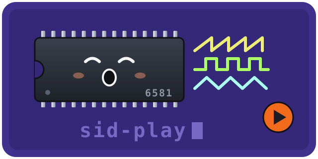

<p align="center">
  
</p>

<p align="center">
  <b>Commodore 64 music, played by a cycle-stepped SID emulator in Rust.</b><br>
  Permissively licensed by default. Honest about what that costs.
</p>

---

`sid-play` takes a PSID tune from the High Voltage SID Collection, runs the
tune's own 6510 machine code one clock cycle at a time, and feeds every
register write to an emulated MOS 6581 SID chip, which renders a WAV file.

```sh
cargo run --release -p sid-play --bin render -- tune.sid --seconds 60 --out tune.wav
```

## The crates

Three crates in three repositories, all on crates.io:

| | Crate | What it is | Licence |
|---|---|---|---|
|  | [`mos6581`](https://github.com/aovestdipaperino/mos6581) | The SID chip: oscillators, envelopes, filter, output stage, resampler. Stepped once per Φ2 cycle. | MIT OR Apache-2.0 |
|  | [`sid-play`](crates/sid-play) | The player: PSID loader, a minimal C64 around the tune (CIA timer, memory, call stubs), the `render` binary and a WAV writer. | MIT OR Apache-2.0 |
|  | [`sid-gpl-data`](https://github.com/aovestdipaperino/sid-gpl-data) | Borrowed measurement data, kept in a jar. Used only if you ask for it. | GPL-2.0-only |

The CPU is a separate project: [`mos6510`](https://github.com/aovestdipaperino/mos6510)
([crates.io](https://crates.io/crates/mos6510)), a cycle-exact 6510 that passes
Tom Harte's per-cycle test suite and Klaus Dormann's functional test.

## How it got here

This started as one crate called rust-sid, licensed GPL-2.0 because a few of its
tables came from reSID. For a long time 13 of 16 sampled tunes played nothing
at all, and the investigation pointed everywhere except at the CPU crate it was
using, which turned out to ignore Y in `LDA (ptr),Y` and to never set the carry
flag in binary `ADC`. Replacing that CPU with `mos6510` made all 16 play.

With the music working, the licence was the next problem. One GPL table makes
the whole crate GPL. So every source file went through a provenance audit
(recorded in [`docs/provenance.md`](https://github.com/aovestdipaperino/mos6581/blob/main/docs/provenance.md)): each table, constant
and formula was traced to a public source, an own derivation, or a GPL origin.
Everything with a GPL origin moved into `sid-gpl-data`. The values the chip
cannot run without were then written again from public sources only (the MOS
datasheet, the chip designer's published interview, the SID patent, C64
schematics) by an author who was not allowed to look at any emulator's code.
Each value carries its source; the few that are plain judgement calls say so.

## The feature switch

```sh
# Default: GPL-free. mos6581 and sid-play are MIT OR Apache-2.0.
cargo run --release -p sid-play --bin render -- tune.sid --out tune.wav

# Measured reSID tables and libsidplayfp's power-on pattern.
# This build, and anything you distribute from it, is GPL-2.0.
cargo run --release -p sid-play --features gpl-data --bin render -- tune.sid --out tune.wav
```

If you use these crates as a library, never enable `gpl-data` in a library:
Cargo unifies features, so one dependency turning it on makes the whole program
GPL. Leave the choice to the final binary.

## What the default build gives up

Measured, not guessed. `crates/sid-play/scripts/fidelity-gap.sh` renders tunes
both ways and compares them. Across 16 HVSC tunes, Last Ninja and the two test
fixtures, every tune plays in the default build, with tonality medians from
0.34 to 0.87. The differences that matter:

- Combined waveforms (triangle, sawtooth and pulse mixed) are approximated as
  the bitwise AND of the pure waveforms, which is brighter than real silicon.
- The filter cutoff follows the datasheet's nominal linear 30 Hz to 12 kHz
  range. Real 6581s close at a much higher frequency, so tunes that lean on a
  nearly closed low-pass filter come out quieter; one test fixture is about 25x
  quieter than with the measured curve.
- Envelope curve shapes, the noise generator's wiring, the resonance range and
  the DC levels are clean-room values, so they sound close but not identical.

The full list is in the "Known default-build fidelity gaps" section of
[`docs/provenance.md`](https://github.com/aovestdipaperino/mos6581/blob/main/docs/provenance.md), and the per-tune numbers are in
[`HANDSOFF.md`](HANDSOFF.md).

## Where it is going

`sid-gpl-data` is meant to shrink to nothing. Each item in it gets a
clean-room replacement in turn: the filter cutoff curve first, then the
combined-waveform tables, then the power-on pattern. When the jar is empty, it
and the feature are deleted, and the whole stack is permissive with no switch
to remember.

## Testing

```sh
cargo test --workspace                              # GPL-free build
cargo test --workspace --features sid-play/gpl-data # measured-data build
```

With the measured data, renders are checked to be bit-identical to the output
from before the crate split.

## Credits

The measured data in `sid-gpl-data` comes from reSID by Dag Lem and from
libsidplayfp; their copyright notices are reproduced in that crate's README.
The SID chip was designed by Bob Yannes, whose 1996 interview is one of the
public sources the clean-room values cite.

## Licence

`mos6581` and `sid-play`: MIT OR Apache-2.0, at your option. `sid-gpl-data`:
GPL-2.0-only. Each lives in its own repository; this one holds the player and
its documents, which are MIT OR Apache-2.0.
