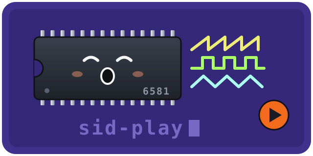

<p align="center">
  
</p>

# sid-play

Plays C64 PSID tunes through the [`mos6581`](https://crates.io/crates/mos6581) SID emulator. The 6510
code runs on the cycle-exact [`mos6510`](https://crates.io/crates/mos6510) crate
and the chip output is written to a WAV file by default (`render --sink audio`
plays it live through the default audio device, with `--features playback`). RSID files are not supported.

Licence: MIT OR Apache-2.0.

## Usage

```sh
cargo run --release -p sid-play --bin render -- tune.sid --seconds 20 --out out.wav
```

Playing out loud:

```sh
cargo run --release -p sid-play --features playback --bin render -- tune.sid --sink audio
```

`--sink wav` (the default) writes the file named by `--out`; `--sink audio`
plays through the default output device and ignores `--out`. It needs the
`playback` feature, the only one, which pulls in `cpal`; without it the default
build has no dependencies besides `mos6510` and `mos6581`. `--seconds` bounds
the length either way.

`--subsong N` selects a subsong (0-based). `--trace` prints diagnostics about
where the tune ran, what it read and which chip registers it wrote. `--ntsc`
uses the 60 Hz frame clock. `--poweron FILE` starts the tune from a 1024-byte
RAM image read from FILE instead of the built-in one. `--probe` prints the
resolved header and exits.

## Fidelity

The build has no GPL code or data and no optional GPL path. The chip uses
clean-room models for the filter cutoff, the combined waveforms and the chip
constants, and the player starts each tune from a clean-room power-on RAM image
built from documentation. See the "Clean-room defaults" and "Known default-build
fidelity gaps" sections of [`docs/provenance.md`](https://github.com/aovestdipaperino/mos6581/blob/main/docs/provenance.md).

## Tonality on real tunes

`scripts/tonality.py out.wav` (in the workspace checkout only; it is not shipped
in the published crate) prints the median autocorrelation peak of a render: 0.00
is silence, higher is more tonal. Over 10 s renders of the 17 tunes in the
workspace's `data/` directory:

```
tune                                  tonality
05-09-87                                 0.60
4_Soccer_Sims_Soccer_Skills              0.66
5_Title_Tunes                            0.73
64_Dwarfs_on_XTC                         0.85
720_Degrees                              0.84
Acceleration-mix                         0.42
ACE_II                                   0.70
Action_Biker                             0.79
All_Points_Bulletin                      0.77
All_Terrain_Vehicle_Simulator            0.70
Alternative_World_Games                  0.70
Antics                                   0.83
Ark_Pandora                              0.51
Artura                                   0.81
Athena                                   0.62
Axel_F                                   0.34
last_ninja                               0.58
```

No tune is silent and none is below 0.20; the lowest are `Axel_F` at 0.34 and
`Acceleration-mix` at 0.42. Tonality shows that a tune plays, not that it sounds
right.
